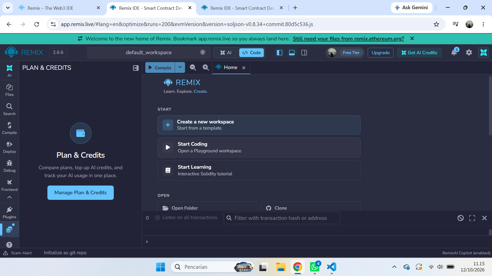
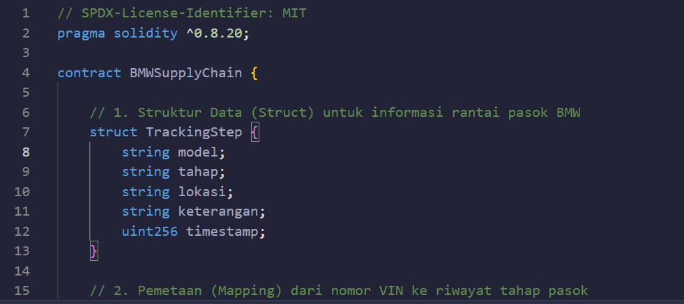
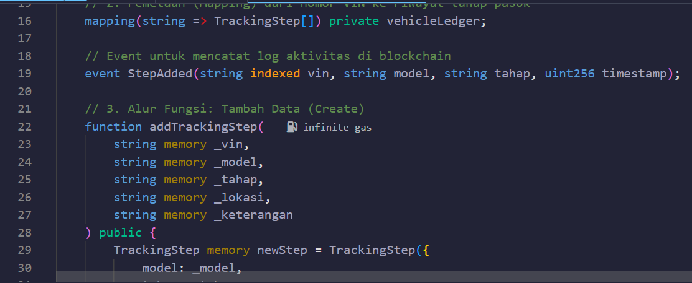
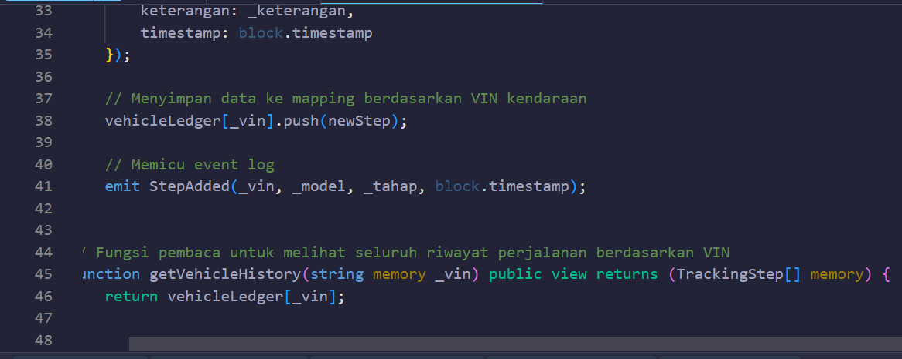
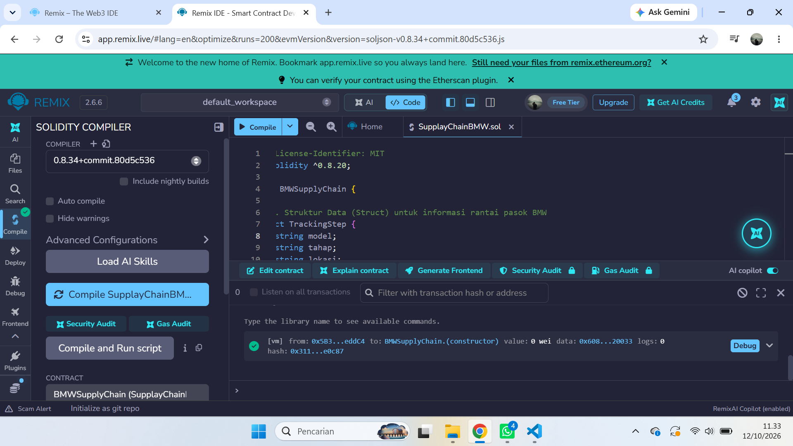
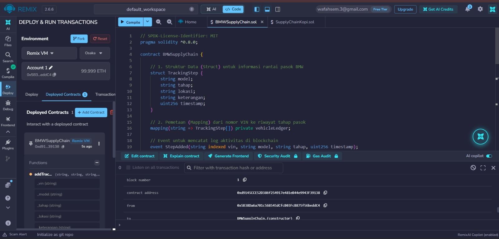
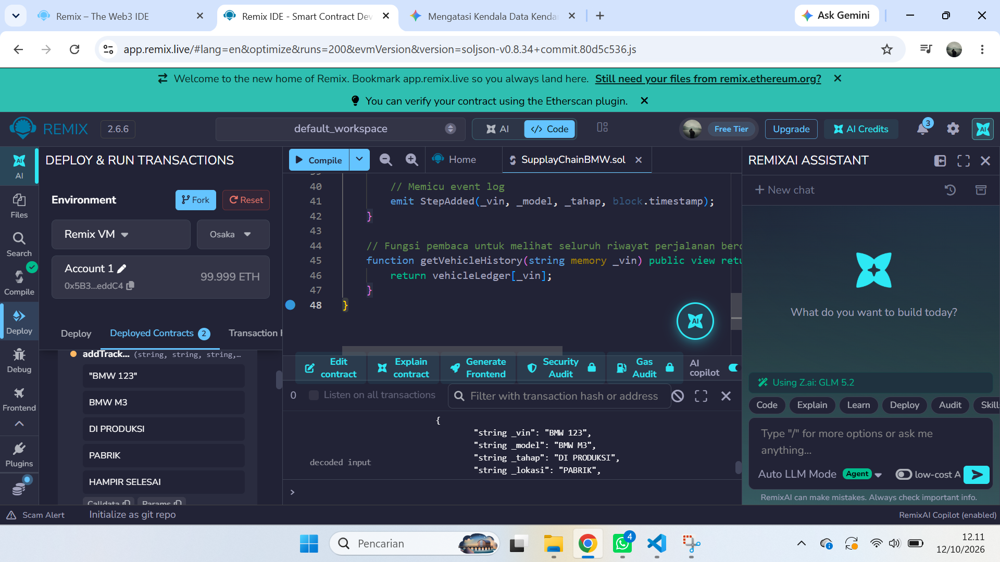
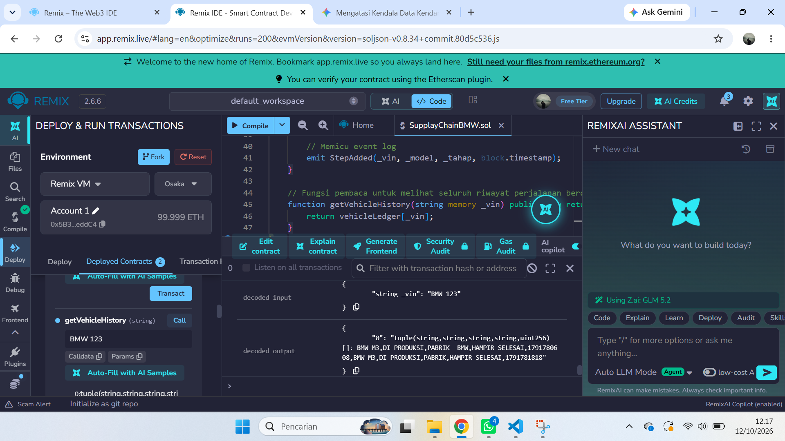
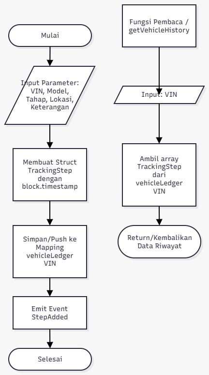

PRAKTIKUM 6 :MEMBUAT SMART CONTRACT DENGAN SOLIDITY DI REMIX

ANGGOTA KELOMPOK:
1. WAFAH KHONIA
2. NIZAR AFTANA NURSYABAN
3. WAHYU

TUJUAN PEMBELAJARAN:

SETELAH PRAKTIKUM INI, MAHASISWA DI HARAPKAN MAMPU:

1. Memahami konsep dasar kontrak pintar pada Blockchain.
2. Menggunakan platform Remix untuk menulis, mengompilasi, dan men-deploy smart contract berbasis Solidity.
3. Mengimplementasikan fungsionalitas dasar kontrak pintar yang melibatkan variabel negara dan fungsi.
4. Melakukan interaksi dengan smart contract yang sudah ter-deploy melalui Remix.

PROSES PRAKTIKUM
1. Buka login Remix IDE melalui Gmail,Bukti:

2. Buka file baru dengan nama file(Supply Chain BMW)

3. MENGCOMPILE

DEPLOY SMART CONTRACT

1. Deploy Smart Contract

2. . Menambahkan Data Tahap Produksi (addTrackingStep)

 
 3. Memeriksa Riwayat Kendaraan (getVehicleHistory)
 
 
 EVALUASI TUGAS KELOMPOK
 1. Desain flowchart

  

File Siap Download
https://bit.ly/3W0shMw

  FILE SUPPLY CHAIN BMW
1. Isi dari file
~~~
// SPDX-License-Identifier: MIT
pragma solidity ^0.8.20;

contract BMWSupplyChain {
    
    // 1. Struktur Data (Struct) untuk informasi rantai pasok BMW
    struct TrackingStep {
        string model;
        string tahap;
        string lokasi;
        string keterangan;
        uint256 timestamp;
    }

    // 2. Pemetaan (Mapping) dari nomor VIN ke riwayat tahap pasok
    mapping(string => TrackingStep[]) private vehicleLedger;

    // Event untuk mencatat log aktivitas di blockchain
    event StepAdded(string indexed vin, string model, string tahap, uint256 timestamp);

    // 3. Alur Fungsi: Tambah Data (Create)
    function addTrackingStep(
        string memory _vin,
        string memory _model,
        string memory _tahap,
        string memory _lokasi,
        string memory _keterangan
    ) public {
        TrackingStep memory newStep = TrackingStep({
            model: _model,
            tahap: _tahap,
            lokasi: _lokasi,
            keterangan: _keterangan,
            timestamp: block.timestamp
        });

        // Menyimpan data ke mapping berdasarkan VIN kendaraan
        vehicleLedger[_vin].push(newStep);
        
        // Memicu event log
        emit StepAdded(_vin, _model, _tahap, block.timestamp);
    }

    // Fungsi pembaca untuk melihat seluruh riwayat perjalanan berdasarkan VIN
    function getVehicleHistory(string memory _vin) public view returns (TrackingStep[] memory) {
        return vehicleLedger[_vin];
    }
}
~~~