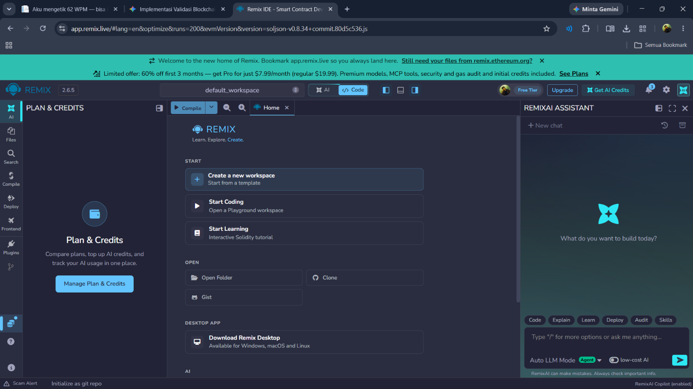
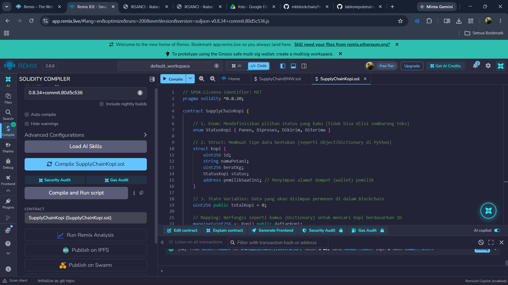
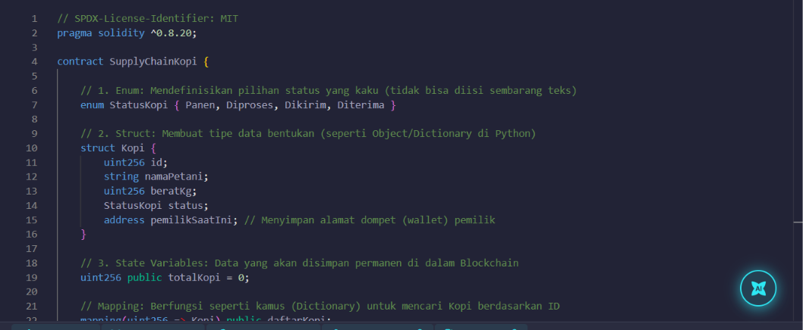
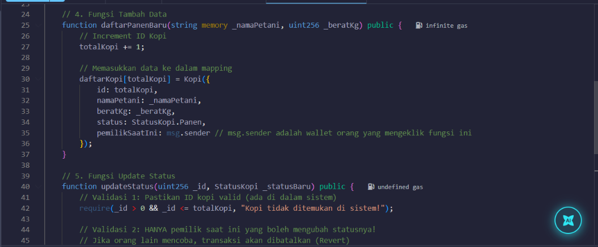
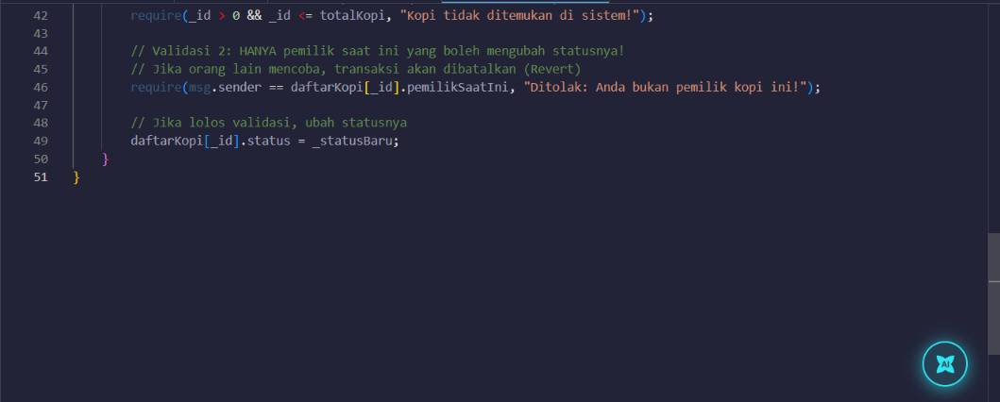
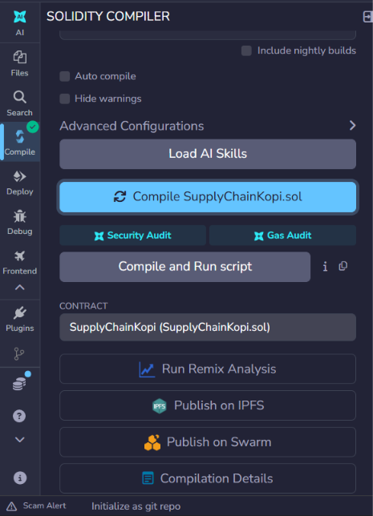
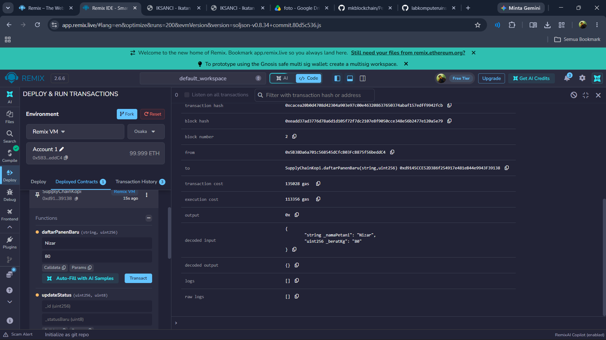
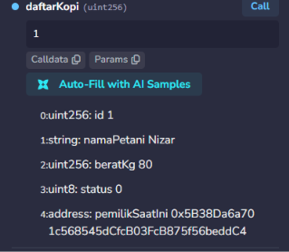

# Praktikum 6: membuat Smart Contract dengan Solidity di remix

## Tujuan Pembelajaran 
Setelah menyelesaikan praktikum ini, mahasiswa diharapkan mampu:
1. Memahami konsep dasar dari smart contract pada Blockchain.
2. Menggunakan platform Remix untuk menulis, mengompilasi, dan men-deploy smart contract berbasis Solidity
3. Mengimplementasikan Fungsionalitas dasar smart contract yang melibatkan state variabel dan fungsi.
4. melakukan interaksi dengan smart contract yang sudah ter-deploy melalui remix

### Proses Praktikum ###

1. Buka [Remix IDE] login via Gmail, bukti:

2. Buat baru file dengan nama file SupplyChainKopi.sol

3. Compile Smart Contract

4. Deploy

5. Memanggil data Panen
